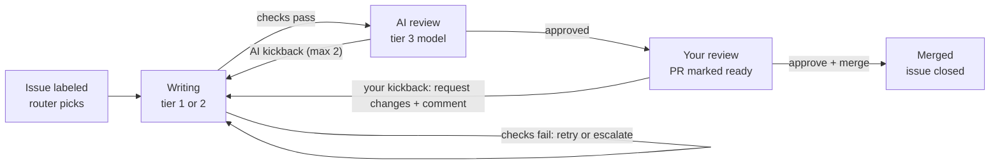
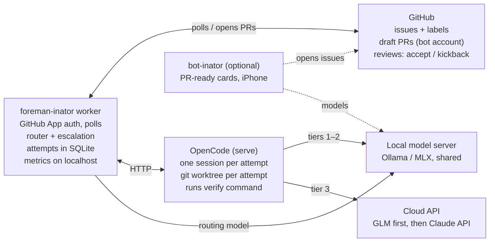

# foreman-inator — Spec

2026-11-23 · Brooks Forsyth · Source of truth: the Claude doc "foreman-inator — Spec"; this file is its export, with the two diagrams redrawn in Mermaid.

## Overview

foreman-inator is a GitHub App plus a worker that runs on your Mac. You label an issue, the worker picks the cheapest model likely to solve it and opens a draft PR. Your PR review is the accept or the kickback, and every outcome is recorded per model.

GitHub is the board: issues, PRs, reviews and comments. The worker keeps only what GitHub doesn't have: routing, escalation, attempt history and metrics. Bot-inator is an optional client.

| Area | GitHub (via the App) | Worker on your Mac | bot-inator (optional) |
| --- | --- | --- | --- |
| Tickets | Issues, labels, comments | Mirrors each labeled issue in SQLite | Opens an issue from chat or a noticed idea |
| Code changes | Draft PRs from the App's bot account | Runs OpenCode in a worktree per attempt | None |
| Review | Approve and merge, or request changes | Reads reviews and records outcomes | "PR ready" card, approve from the iPhone remote |
| Models | None | Routing, escalation, router training | Shares the model server |

**Goal for v1:** replace most Max-plan usage with local models plus pay-as-you-go cloud fallback, with your approval rate visible per model.

## Ticket lifecycle



A cheap model writes; a stronger model reviews before you ever see it. Failed checks loop inside the worker. The AI reviewer can kick a change back twice; after that the writer moves up one tier, and if tier 3 is already writing, the PR goes to you with the reviewer's notes. Only a reviewer-approved PR is marked ready for your review. Your "Request changes" sends it back with your comment as the note. Closing the issue without merging drops the ticket, and dropped tickets are excluded from metrics.

## Data model

SQLite tables: tickets hold the request, attempts hold each model run, kickbacks hold rejections, reviews hold AI review verdicts, experiments hold model and prompt comparisons. Together the history doubles as the router's training data.

Each ticket mirrors one GitHub issue, so tickets also store `issue_number` and `pr_number`. The column is derived from GitHub state: labeled → todo, worker running → in_progress, draft PR awaiting review → testing, merged → done, closed unmerged → dropped. A `kickback:<tag>` label set during review gives the tag, and the review comment is the note.

**tickets**

| Field | Type | Notes |
| --- | --- | --- |
| id | int | Unique, never reused |
| title, request | text | The ask, in your words |
| repo, base_branch | text | Where it runs |
| issue_number, pr_number | int | The GitHub issue and its PR |
| owned_files | json | Files the ticket may touch; used for locking |
| column | enum | todo · in_progress · testing · done · dropped |
| source | enum | issue · botinator · ci |
| route_reason | text | Why the router picked the first model |
| trace_id | text | The ticket's trace |
| accepted_attempt_id | int | Set when you accept |
| created_at, done_at | time | |

**attempts**

| Field | Type | Notes |
| --- | --- | --- |
| id, ticket_id | int | |
| model, tier | text, int | e.g. inkling-2-mini, tier 1 |
| variant_id | text | Model + prompt version |
| trigger | enum | first · escalation · kickback · ai_kickback · explore |
| writer_mode, review_mode | enum | The repo's profile when the attempt started |
| worktree, branch | text | One git worktree per attempt |
| tests_passed, build_passed | bool | From the repo's verify command |
| diff_files, diff_lines | int | Size of the change |
| tokens_in, tokens_out, cost_usd, seconds | num | |
| outcome | enum | accepted · kicked_back · failed_checks · superseded |

**kickbacks**

| Field | Type | Notes |
| --- | --- | --- |
| id, attempt_id | int | Charged to the attempt that produced the change |
| by | enum | user · reviewer |
| tag | enum | wrong · incomplete · broke · style |
| note | text | Sent to the next attempt as context |
| failure_step | enum | From the Tracing list, once the trace is labeled |
| created_at | time | |

**reviews**

| Field | Type | Notes |
| --- | --- | --- |
| id, attempt_id | int | One review per writer attempt |
| reviewer_model | text | Must be a different model family from the writer |
| variant_id | text | Model + prompt version |
| verdict | enum | approve · request_changes · handed_to_user |
| tests_passed | bool | Reviewer's own run in the worktree |
| changed_line_coverage | num | % of changed lines executed by tests |
| tests_nonvacuous | bool | New tests fail when the source change is reverted |
| ran_app | enum | yes · no · not_runnable |
| tag, note | enum, text | Same tags as human kickbacks |
| tokens_in, tokens_out, cost_usd | num | Counted in cost per accepted ticket |

**experiments**

| Field | Type | Notes |
| --- | --- | --- |
| id | int | |
| role | enum | writer · reviewer |
| champion_variant, challenger_variant | text | Model + prompt version |
| mode | enum | replay · seeded · shadow · split · pair |
| traffic_share | num | For split mode, e.g. 0.15 |
| status | enum | running · promoted · rejected |
| started_at, ended_at, result_note | time, text | |

Agents receive their ticket (request, owned files, kickback notes) in the session prompt, so there is no markdown copy of the board.

## Routing and escalation

Each ticket starts on the cheapest tier that seems likely to work and moves up only when checks fail or you kick it back twice. The router's guess matters less than the escalation, because coding results can be checked.

| Tier | Model (initial pick) | Where | Use for |
| --- | --- | --- | --- |
| 1 | Inkling 2 Mini (26B, 5.4B active) | Local | Small, mechanical changes |
| 2 | Qwen3.8-27B dense | Local | Normal features and bug fixes |
| 3 | GLM plan first, then Claude API | Cloud, pay per use | Large refactors, anything that failed twice locally |

**Start rule** (gets smarter as data grows):

1. **v1, rules:** small local model classifies the request as small, normal, or large → tier 1, 2, or 3.
2. **After about 50 accepted tickets, nearest neighbors:** embed the request, find the 10 most similar finished tickets, and start at the cheapest tier that was accepted for most of them. `route_reason` records which tickets it matched.
3. **After a few hundred, a classifier**, and LoRA fine-tuning only if it beats the classifier on held-out tickets.

A `tier:N` label on the issue overrides the router for that ticket, and the override is recorded in `route_reason`.

**Escalation:**

- Checks fail → retry once on the same tier with the error output, then move up one tier.
- Kicked back once → retry on the same tier with your note.
- Kicked back twice, or tagged *wrong* → move up one tier.
- Tier 3 fails → the ticket stays in progress and is flagged for you. No silent loops.

**Exploration:** on about 10% of tickets, start one tier lower than the router picked, so the data covers cheaper models too. These attempts are marked `explore` and never count against a model in the metrics if they fail.

**Spend limits:** a daily and monthly cap on cloud spend. When the cap is hit, tier 3 attempts wait for your approval.

**AI review** (on by default; `review:skip` label turns it off for trivial changes). After checks pass, a tier 3 model from a different family than the writer reviews the change, cheapest and most objective checks first:

1. Run the tests and build in the worktree.
2. Measure coverage of the changed lines and flag new code no test executes.
3. Revert the source change, keep the new tests, and confirm they fail (the non-vacuous rule).
4. Run the change when it can run on its own: a CLI command, a script, or a Playwright pass for web pages. Otherwise record `not_runnable`.
5. Read the diff against the issue: does it do what was asked, miss part of it, or break something nearby?

The reviewer sees only the issue and the diff, not the writer's reasoning. It posts its verdict as a PR review from the bot account, so the exchange stays in the PR history. Two automatic kickbacks escalate the writer one tier.

**Repo profiles:** each repo has two settings. Cost is what speed and correctness are bought with, so there is one setting for each: `writer` spends money to save time, `review` spends money and time to catch bugs. A repo with no setting uses `normal` for both, which is the behaviour described above.

| `writer` | Start tier | Failed checks | Exploration | Cloud writer |
| --- | --- | --- | --- | --- |
| `thrifty` | Router's pick | 2 retries on the same tier, then move up | About 25% | Waits for your approval |
| `normal` | Router's pick | 1 retry, then move up | About 10% | Inside the spend caps |
| `fast` | One tier above the router's pick | Move up on the first failure | Off | Inside the spend caps |

| `review` | What runs after checks pass |
| --- | --- |
| `off` | Nothing. The PR is marked ready for you, as with `review:skip`. |
| `light` | Review steps 1–3 (tests, coverage, non-vacuous). No model reads the diff, so no cloud call. |
| `normal` | All five steps |
| `strict` | All five steps. `review:skip` is ignored, and one automatic kickback escalates the writer. |

Four presets name the common pairs, set with `fman repo set-profile <repo> <preset>`; either setting can also be set by hand.

| Preset | `writer` | `review` | For |
| --- | --- | --- | --- |
| `prototype` | `fast` | `off` | Speed first; minor bugs are fine |
| `personal` | `thrifty` | `light` | Costs little; slow, and some bugs get through |
| `default` | `normal` | `normal` | |
| `production` | `fast` | `strict` | Speed and correctness; costs the most |

A `tier:N` label still wins over the start-tier shift. The shift is applied after the router's guess, and both settings are recorded on every attempt, so the metrics and the learning router can tell a profile's effect from a model's. Every profile keeps the loop caps and the spend caps.

## Metrics view

The metrics page answers one question: which model should handle which kind of work, and what does each accepted change cost? Every metric can be filtered by model, repo, and date range.

| Metric | Definition |
| --- | --- |
| First-try accept rate | Accepted with no kickbacks and no escalation ÷ tickets started on this model |
| Kickbacks per ticket | Mean kickbacks charged to this model's attempts, split by tag |
| Escalation rate | Tickets this model handed up a tier ÷ tickets it started |
| Cost per accepted ticket | Total spend on all attempts ÷ accepted tickets, including the failed attempts |
| Time to accept | Created → accepted, median |
| Router hit rate | Tickets accepted on the tier the router first picked |

AI review adds three more:

- **Reviewer miss rate:** your kickbacks on PRs the reviewer approved ÷ PRs it approved. This is how you know whether to trust it.
- **AI kickbacks per ticket,** per writer model.
- **Writer + reviewer vs. strong writer alone:** cost per accepted ticket for each, to confirm the split actually saves money.

Two trend lines on the page:

- Cost per accepted ticket over time, which should fall as the router learns
- Share of tickets solved locally, the number that tells you whether Max can go

The worker serves the metrics page on localhost. When an issue closes, it also posts a one-line summary comment on the issue: model, attempts, kickbacks and cost.

## Experiments

Every model and prompt change is tested before it becomes the default. Most of that testing replays past tickets overnight, so it costs none of your review time.

A **variant** is a model plus a prompt version, for example `inkling-2-mini / writer-v3`. Prompts are versioned files in the worker's repo, so a prompt change is a commit. Each variant has a role: writer or reviewer. One variant per role is the **champion** (the default); others are **challengers**.

| Mode | Role | How it works | Your time | When to use |
| --- | --- | --- | --- | --- |
| Writer replay | Writer | Rerun merged issues from their base commit; score on passing the merged PR's tests, cost, time | None | Every prompt or model change, overnight |
| Reviewer replay | Reviewer | Replay past PRs; your merges are good, your kickbacks are bad; score catches vs. false kickbacks | None | Every reviewer change |
| Seeded bugs | Reviewer | Take merged PRs, plant a bug (drop an edge case, weaken a test); a good reviewer should catch it | None | Building up reviewer test cases quickly |
| Shadow reviewer | Reviewer | Challenger reviews every live PR alongside the champion; only the champion's verdict counts; both are scored against your eventual merge or kickback | None | Always on once a challenger exists |
| Traffic split | Writer | 10–20% of live tickets go to the challenger; you review as normal | Normal | After a challenger wins on replay |
| Head-to-head | Writer | Two PRs for one issue, you pick one (`ab:pair` label) | Double | Rarely, for a close call |

**Promotion rule:** a challenger becomes champion only after it wins on replay *and* holds up live (shadow or traffic split). Its live accept rate must not fall below the champion's, and its cost per accepted ticket must not be higher. Both variants are judged on the same tickets wherever possible.

**Cautions:**

- **Sample size:** a few tickets a day means dozens per variant before a live difference means anything. Replay sets are where most decisions get made.
- **Stale replays:** rebuild the replay set from the most recent ~100 merges each month as repos change.
- **Cloud cost:** replays of tier 3 variants count toward the spend caps, with their own monthly experiment budget.

## Tracing

Every ticket is one trace, so when a change is kicked back you can see the exact step where the model went wrong. Tracing uses fde-kit's OpenTelemetry setup and exports to the same local backend, so foreman-inator is also a real user of fde-kit.

**Span layout** (ticket is the root):

- `route`: tier picked, reason, matched past tickets
- `attempt` (one per attempt, tagged with `variant_id`)
  - `llm.call`: prompt version, tokens, latency, cost
  - `tool.call`: file reads, searches, edits, shell commands with truncated output
  - `verify`: tests run, tests failed
- `review` (one per AI review)
  - one child span per check: tests, changed-line coverage, test-revert, run app, read diff
  - verdict as a span attribute
- `github`: PR opened, review received; kickbacks are added as events on the attempt they judge

**Capture:** the worker runs a thin OpenAI-compatible proxy in front of the local model server and the cloud APIs. Every model call passes through it and becomes an `llm.call` span, whatever coding agent is used. Tool calls and edits come from OpenCode's session events and the git diff. Large outputs (file contents, logs) are truncated in spans and saved in full as files next to the trace. Traces stay on your Mac.

**Failure-step labeling:** when a kickback arrives (yours or the reviewer's), a model reads the trace and labels where it went wrong:

| Failure step | Example |
| --- | --- |
| misread_issue | Fixed the wrong thing |
| missed_file | Searched, never opened the file with the bug |
| wrong_edit | Right file, wrong change |
| ignored_failure | Saw a failing test and moved on |
| weak_tests | Code is fine, tests prove nothing |
| reviewer_miss | Reviewer approved a change you rejected |

The metrics page shows failure steps per variant, so a fix can target the step that fails (for example, better search instructions for a writer that keeps missing files) instead of defaulting to a bigger model.

**Recording and replay** (fde-kit's record/replay/fork). Every attempt and review is recorded: the base commit, every model response (captured by the proxy), and every tool result. That gives three uses:

| Use | What happens | Model calls |
| --- | --- | --- |
| Replay | Step through a recorded run exactly as it happened, from the trace view | None |
| Regression tests for the worker | Run recorded tickets through new router, escalation or review logic to check it behaves the same | None |
| Fork from failure | Restart a recording at its labeled failure step with a changed prompt or model; tools re-run in a fresh worktree at that point | From the fork onward |

This is different from the experiment replays above, which rerun the whole ticket live. Recordings are compressed; recordings for merged tickets are kept, and the rest are deleted after 90 days.

## Architecture and GitHub mapping



The worker is the only piece that runs code. It authenticates as the GitHub App, polls every 30–60 seconds, and needs no public URL or inbound port. A small webhook relay can replace polling later if you want instant reactions.

| GitHub event | Worker action |
| --- | --- |
| `agent` label added to an issue (by an allowed user) | Create ticket, route, start an attempt |
| `tier:N` label on the issue | Override the router's starting tier |
| Attempt passes checks | Open or update a draft PR linked to the issue; model, tier and cost in the description |
| PR review: Request changes | Kickback: comment becomes the note, `kickback:<tag>` label gives the tag; new attempt |
| PR review: Approve, then merge | Accept: record outcome, close issue, post summary comment |
| Issue closed without merge | Drop the ticket |

The PR stays a draft through AI review. Only a reviewer-approved PR (or one handed over after the loop cap) is marked ready for review, which is what notifies you.

**GitHub App permissions:** Issues (read/write), Pull requests (read/write), Contents (read/write), Metadata (read). Installed only on the repos you pick.

**Safety on public repos:** the worker acts only on labels applied by an allowlist of GitHub users (you), only on branches it created, and never runs code from forks or outside PRs. No self-hosted Actions runner is used, because GitHub recommends those for private repositories only.

**bot-inator (optional):** it can open issues from chat or a noticed idea through the GitHub API, show a "PR ready for review" card, and send approve or request-changes from the iPhone remote. Its consent rules still apply on its side: an idea becomes an issue only after its normal idea card.

## Open source and distribution

foreman-inator is open source from day one, under MIT to match bot-inator. Users run everything themselves, and no shared service is needed.

- **License:** MIT. Apache-2.0 is the alternative if explicit patent terms matter to someone adopting it. Not AGPL, which discourages use at companies.
- **Each user creates their own GitHub App.** `fman setup` uses GitHub's app-manifest flow to register a private foreman-inator App on the user's account in one click and saves its private key locally. There is no shared App and no shared private key, so you run no infrastructure.
- **Open core, later and optional:** the worker stays free. Paid hosted extras could come later if people want them: the webhook relay, a team metrics dashboard, shared replay sets.
- **README states it is a personal project** with no promised support.

**Secrets and local data live outside the repo,** in `~/.foreman-inator/` (permissions 700):

| Path | Contents |
| --- | --- |
| `~/.foreman-inator/app.pem` | The user's GitHub App private key |
| `~/.foreman-inator/config.toml` | App ID, allowed GitHub users, model endpoints; API keys stored as macOS Keychain references, not plain text |
| `~/.foreman-inator/foreman-inator.db` | Tickets, attempts, reviews, experiments |
| `~/.foreman-inator/traces/`, `recordings/` | Traces and run recordings (contain the user's code) |
| `~/.foreman-inator/worktrees/` | Git worktrees for attempts |

The repo's `.gitignore` also covers these, in case someone points the data directory inside the repo (the worker is Python, like fde-kit):

```gitignore
# Secrets and local config
.env
.env.*
!.env.example
*.pem
*.key
config.local.toml

# Runtime data (normally in ~/.foreman-inator)
.foreman-inator/
*.db
*.sqlite
*.sqlite-wal
*.sqlite-shm
traces/
recordings/
worktrees/

# Python
__pycache__/
*.py[cod]
.venv/
.pytest_cache/
.ruff_cache/
.mypy_cache/
.coverage
htmlcov/
dist/
build/
*.egg-info/

# OS and editors
.DS_Store
.idea/
.vscode/
```

**Two more guards:** a gitleaks pre-commit hook and CI check to block committed secrets, and a `fman export --redact` command for bug reports, because raw traces and recordings contain the user's code.

**Distribution:**

| Piece | Where | Name |
| --- | --- | --- |
| Source, releases, changelog | Public GitHub repo | `Bforsyth1234/foreman-inator` |
| Worker install | Python package, installed with `uv tool install` or `pipx install`; Homebrew tap later | `foreman-inator` |
| Command | CLI on the user's PATH | `foreman-inator`, short alias `fman` |
| GitHub App | Created per user by setup | `foreman-inator[bot]` |

**Setup** (`fman setup`) does four things: registers the user's own GitHub App through the manifest flow, checks for OpenCode and Ollama and offers to install them, writes `~/.foreman-inator/config.toml`, and installs a macOS launchd agent so the worker restarts after a reboot. Not listed on the GitHub Marketplace: every user has a private App, so there is no single public App to list.

**Naming note:** plain "Foreman" is crowded. It is a well-known Ruby Procfile tool whose `foreman` command is on many dev machines, and several AI coding projects already use the name, including a Vercel template with nearly the same issue → implementer → cross-vendor reviewer flow. That is why the project is named foreman-inator. Confirm the names are free on PyPI, GitHub, and as a GitHub App name before the first release.

## Milestones and decisions

Milestones 1–2 make the GitHub add-on useful on its own. Bot-inator is optional and comes third, and the router only gets smart once real tickets exist.

1. **GitHub App plus a polling worker on one tier.** The setup command registers your own App via the manifest flow and installs it on one repo, `agent` label → OpenCode on tier 1 in a worktree → draft PR, verify command detected from the repo, reviews mapped to accept and kickback, basic tracing (model proxy, attempt and verify spans) and run recording through fde-kit. Use it for a week.
2. **Tiers and escalation.** All three tiers, the escalation rules, `tier:N` override, AI review stage, spend caps, file locks for parallel tickets, metrics page, summary comment on close.
3. **bot-inator integration (optional).** Open issues from chat or ideas, "PR ready" cards, approve or request changes from the iPhone remote.
4. **Learning router.** Nearest-neighbor start rule, 10% exploration, router hit rate in metrics. Experiments: variant tracking, writer and reviewer replay sets, shadow reviewer. Failure-step labeling on every kickback. Replay in the trace view, and recorded tickets as regression tests for the worker.
5. **Later:** webhook relay for instant reactions, traffic split and head-to-head experiments, seeded-bug reviewer tests, fork-from-failure experiments, a classifier then a LoRA router, and publishing the App for others (each user runs their own worker).

**Decisions** (answered 2026-11-23)

- **Verify command:** detected from the repo (package.json scripts, pytest, `swift typecheck`, Makefile). If nothing is found, the ticket is flagged once and the command you enter is saved for that repo.
- **Web UI:** GitHub is the board. The worker serves only a local metrics page.
- **Tier 1 (2026-11-23):** Inkling 2 Mini (Thinking Machines, open weights, about 20 GB on Ollama 0.40.17 or newer) replaces Qwen3.6 35B-A3B. Its maker reports coding scores level with Qwen3.8-27B at a fraction of the time per task, and it puts a second model family on the local tiers, so a move from tier 1 to tier 2 changes family. Tier 2 stays Qwen3.8-27B until the metrics say otherwise.
- **Tier 3:** both. The GLM plan is tried first because it's a flat fee; the Claude API is used on escalation from GLM, or from the start for ticket types where GLM's accept rate is low.
- **todo.md:** for the repos foreman-inator works on, the board replaces task tracking and the rules header moves to `AGENTS.md`. foreman-inator's own build is tracked in this repo's `todo.md` until it can run its own tickets.
- **Name:** foreman-inator (renamed from Agent Board, then Foreman, on 2026-11-23), matching bot-inator. Repo and package foreman-inator, command foreman-inator with alias fman, bot account foreman-inator[bot]; confirm the names are free before the first release.
- **Open source (2026-11-23):** yes, from day one, MIT license. Each user registers their own GitHub App; secrets and data stay in `~/.foreman-inator/`.
- **Host (2026-11-23):** GitHub Issues, through a GitHub App plus a local worker that polls. Not a self-hosted Actions runner, because your repos are public.
