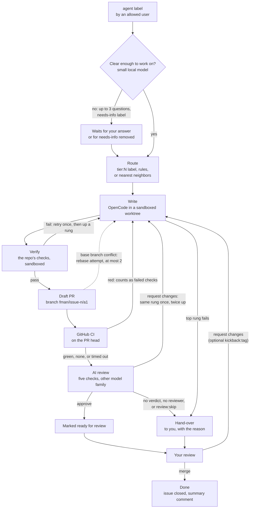
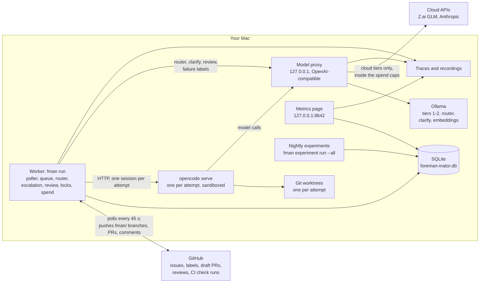

# How foreman-inator works

This describes what the code does today. Where it differs from the design in
[SPEC.md](../SPEC.md), the difference is said here and recorded in
[DONE.md](../DONE.md). None of it has yet been run end to end against real
GitHub and real models; see the live checks in [todo.md](../todo.md#live-checks).

Terms:

- **Ticket:** the worker's record of one labeled issue, kept in SQLite.
- **Attempt:** one run of one model on a ticket: write the change, then run the checks.
- **Tier:** a cost level. Tiers 1 and 2 are local models; tier 3 is cloud models.
- **Rung:** one configured writer model. The escalation ladder is every model
  in `config.toml`, ordered by tier and then by the order in the file.
- **Kickback:** a change sent back with a note and optionally a tag (`wrong`,
  `incomplete`, `broke`, `style`), by you or by the AI reviewer.
- **Hand-over:** the worker stops and gives the ticket to you, with the reason
  on the issue and, when there is a PR whose checks passed, in the PR.
- **Variant:** a model plus a prompt version, written `model/prompt@hash8`, for
  example `inkling-2-mini/writer-v1@0265fdf3`.
- **Champion:** the variant in use for a role (writer or reviewer). Other
  variants are challengers.

## The lifecycle

Step by step:

1. **Poll.** The worker polls each repo in `config.toml` every 45 seconds
   (`poll_interval_seconds`). It needs no public URL and no inbound port. A
   label, review or answer counts only if a user in `allowed_users` gave it;
   the bot's own actions never count.
2. **Clarify.** Before routing, a small local model (the first local model of
   the lowest tier) reads the issue. If it cannot be worked on as written, the
   bot posts up to three questions, adds `needs-info`, and parks the ticket
   until an allowed user answers in a comment or removes the label. It asks at
   most once per ticket. Any failure of this check means "go ahead as
   written". Turn it off with `clarify = false`.
3. **Route.** A `tier:N` label decides the start tier with no model call.
   Otherwise, once there are `knn_threshold` (50) accepted tickets, the
   nearest-neighbor router embeds the issue with `embeddinggemma`, finds the 10
   most similar accepted tickets, and starts on the tier most of them were
   accepted on (a tie goes to the cheaper tier). Below the threshold, or if
   embedding fails, the rules router asks the same small local model to call
   the issue small, normal or large (tier 1, 2 or 3); any error falls back to
   tier 2. On about 10% of tickets (`explore_rate`) the start is one tier lower,
   so the data covers cheaper models too; a failed exploration attempt goes
   straight to the routed tier and is not counted against the model.
4. **Write.** The worker makes a git worktree on `fman/issue-<n>/a<attempt>`,
   builds the writer prompt (the issue, the repo's `AGENTS.md` or `CLAUDE.md`,
   earlier notes and check output), and starts one `opencode serve` for the
   attempt. OpenCode runs under the sandbox and reaches models only through
   the worker's proxy. The worker commits what it wrote.
5. **Verify.** The worker runs the repo's check command (detected, or saved
   with `fman repo set-verify`) under the sandbox. A ticket with no command is
   flagged once on the issue.
6. **Draft PR.** The change is force-pushed to the ticket's PR branch
   (`fman/issue-<n>/a1`; one PR per ticket) and a draft PR is opened or
   updated. Its description says "Closes #n" and gives the model, tier, cost,
   check counts, sandbox state, CI state and attempt history. It carries no
   model reasoning or file contents.
7. **GitHub CI.** The worker reads the check runs on the PR head. None after 2
   minutes: it continues. Still pending after 30 minutes: it continues with a
   note. A red job counts as failed checks, and the next attempt gets the job's
   log tail. A job that is also red on the base branch is not charged to the
   change. Without the Checks and Actions permissions it skips this step with
   one warning.
8. **AI review.** See [AI review](#ai-review). An approve marks the PR ready
   for review, which is what notifies you. A request for changes is an AI
   kickback. No verdict is a hand-over.
9. **Your review.** Merging is the accept: the attempt is recorded as
   accepted, the issue closed, and a one-line summary posted. Request changes
   is a kickback: your review comment and its line comments become the note,
   and a `kickback:<tag>` label on the PR gives the tag. Closing the issue
   unmerged drops the ticket and leaves it out of the metrics. Removing the
   `agent` label also drops it.
10. **Rebase.** If GitHub reports the PR no longer merges with its base, the
    worker replays the change onto the new base in a fresh worktree, leaves
    git's conflict markers for the model to resolve, and runs a `rebase`
    attempt on the same model. It does this at most twice per ticket, then
    hands over.

## Escalation

The rules, counted per rung:

- Checks fail (locally or in CI): one retry on the same rung with the error
  output, then up one rung.
- You kick it back once: one retry on the same rung with your note.
- You kick it back twice, or tag it `wrong`: up one rung.
- The AI reviewer kicks it back once: same rung; twice: up one rung.
- Up from the last rung: hand-over. The PR is marked ready if its last change
  passed its checks and CI; otherwise it stays a draft.
- An attempt cut short by a crash or restart is rerun, at most 3 times per ticket.

Every configured writer model is a rung. With the default config the ladder is
Inkling 2 Mini, GLM, Claude Opus, Claude Fable (tier 2 is GLM, an open-weights
cloud model; add Qwen3.8 27B as a local tier 2 to keep tier 2 on this Mac), so
"tier 3 fails" means Opus, then Fable, then you. The attempt bound is the number
of rungs times 6, plus 3 interrupted reruns, plus 2 rebase attempts: 29 attempts
on the default four-rung ladder. A local-only repo (`fman repo set-cloud off`)
stops at its last local rung. Nothing loops past it.

## AI review

After the checks pass, a reviewer model from a different family than the
writer (`family` in config) reviews the change. It is the reviewer champion's
model when its family differs, otherwise the first model in `reviewer_models`
(`claude-opus`, then `glm`) whose family differs. If none differs, the PR is
handed to you unreviewed. The five checks, cheapest first:

1. Run the tests and build in the worktree. A failure sends the change back
   tagged `broke`; the rest are skipped.
2. Measure test coverage of the changed lines (with `coverage` in the target
   repo's environment) and flag new functions no test runs. When coverage
   cannot be measured it is recorded as unknown, not guessed.
3. Revert the source change in a scratch worktree, keep the new tests, and run
   them. Tests that still pass prove nothing (they are vacuous).
4. Run the change when it can run on its own (a console script or `__main__`
   with `--help`, or `npm run start`); otherwise record `not_runnable`.
5. Give the model the issue, the changed files, the results of checks 1–4 and
   the diff, and ask whether the change does what was asked.

Checks 1–4 are plain code. A hard finding from checks 2–4 (vacuous tests, an
untested new function, a regression against the base) sends the change back
without asking the model, so the model cannot overrule it. The model must
answer with one JSON object; a malformed answer is retried once, then the
change is handed to you, never approved. Timeouts, model errors and spend
refusals also end in a hand-over.

The reviewer never sees the writer's reasoning or transcript. Its checks run
under the sandbox. The verdict is posted as a comment review from the bot,
because GitHub does not let a PR's author approve or request changes on it;
the verdict itself is in the review text and the database. `review:skip` on
the issue (applied by an allowed user) skips the review and hands the PR to
you once the checks and CI pass.

## Spend caps and approvals

Only calls to `cloud` models count; local calls cost $0 and are never limited.
The live caps are $5 a day and $50 a month by default, in the Mac's local
calendar; replays and shadow reviews draw on a separate $10 monthly
experiments budget and never on the live caps. The live caps apply to every
cloud call, the AI reviewer's included.

Before each cloud call the proxy reserves an estimate. If spent plus reserved
plus the estimate would pass a cap, the call is refused before anything is
sent, and the ticket pauses (`WAITING: spend approval` in `fman status`). The
pause is not counted as a failure. `fman approve-spend <ticket>` allows one
more attempt of that ticket, with its review, up to one daily cap's worth past
the caps; the next attempt asks again. A paused ticket also resumes by itself
when the cap resets. A cap of 0 turns cloud calls off.

GLM is priced at its pay-as-you-go list price even on the flat-fee Coding Plan,
so it over-counts toward the caps on purpose.

## File locks

Each ticket wants a set of files: the paths named in the issue, widened by
every attempt's diff. A ticket starts or publishes only when it holds locks on
all of them; otherwise it waits (`WAITING: on files held by ticket(s) #N`). The
earlier ticket wins, a deadlock is broken by the youngest ticket giving up its
locks, and locks are released when a ticket is merged or dropped. With the
default `max_parallel_per_repo = 1`, one ticket per repo runs at a time, so
locks matter only when you raise it. An issue that names no files holds
nothing until its first diff.

## Architecture

- **Worker** (`fman run`, kept alive by the `com.foreman-inator.worker` launchd
  agent): authenticates as your GitHub App, polls, and drives every ticket
  through the lifecycle. All state changes go through one lifecycle function,
  and the work queue is rebuilt from the database each pass, so a crash at any
  point resumes without a second PR, comment or counted attempt.
- **Poller:** reads issues, label events, reviews, line comments, check runs
  and mergeability. It never writes to GitHub itself.
- **Model proxy:** an OpenAI-compatible server on 127.0.0.1 in front of Ollama
  and the cloud APIs. Every model call goes through it and becomes one
  `llm.call` span with the prompt version, tokens, latency and cost. It applies
  the spend caps, puts the API key on the upstream request only, and refuses a
  cloud model with no key or no https before sending anything.
- **OpenCode driver:** starts one `opencode serve` per attempt on 127.0.0.1
  with a random password, with its own config pointing at the proxy. Your own
  OpenCode config, credentials and SSH agent are not passed to it. Web fetch
  and web search are denied.
- **Sandbox:** `sandbox-exec` with a deny-by-default profile for OpenCode, the
  verify command and the reviewer's checks: writes only to the attempt's
  worktree and scratch folder, no reads of your home folder or
  `~/.foreman-inator`, network only to the proxy port (or open for a repo's
  checks with `sandbox_network = "allow"`). It does not limit CPU, memory or
  disk, and world-readable system paths stay readable. `man sandbox-exec`
  marks the tool deprecated; it still ships with macOS.
- **Store:** SQLite at `~/.foreman-inator/foreman-inator.db`: tickets,
  attempts, kickbacks, reviews, variants, experiments, replay results, spend
  and file locks.
- **Traces:** every ticket is one OpenTelemetry trace (route, attempts with
  their `llm.call`, `tool.call` and `verify` spans, reviews with one span per
  check, GitHub events, kickbacks). Spans are written to
  `~/.foreman-inator/traces/<ticket>/` and also exported over OTLP to
  `http://localhost:6006`, where a local trace viewer such as Phoenix can
  receive them; with nothing listening, nothing is lost locally.
- **Recordings:** every attempt and review is recorded in
  `~/.foreman-inator/recordings/<ticket>/`: the prompt, every model response
  and every tool result.
- **Retention:** once a day the worker deletes recordings and traces of
  tickets that are not merged once they are older than `retention_days` (90
  by default). A merged ticket's recordings are kept for good, and an open
  ticket's or a running attempt's are never touched. The same pass sweeps
  scratch space a crashed launch left in `sandbox/` and `opencode/attempts/`,
  old experiment logs in `replays/work/`, and package caches of repos removed
  from the config. `fman prune --dry-run` lists what would go; see
  [setup.md](setup.md#what-gets-deleted-and-when) for the exact rules.

## Experiments

Every model or prompt change can be tested on past tickets before it becomes
the default. A prompt is a file in the package (`prompts/writer-v1.md` and so
on), and its hash is part of the variant id, so editing a prompt makes a new
variant. `fman status` warns `PROMPT CHANGED ... (not promoted)` when the file
on disk differs from the promoted champion's. Put a changed prompt in a new
file (for example `writer-v2.md`), because a prompt edited in place cannot be
replayed against its old text.

What is built:

| Mode | Role | How it works |
| --- | --- | --- |
| Writer replay | Writer | Rerun merged tickets from their base commit with the challenger, copy in the merged PR's tests, and score pass, cost and time against the champion. |
| Reviewer replay | Reviewer | Rerun the reviewer on past PRs: your merges should be approved, your kickbacks caught. Scored as catches, misses and false kickbacks. |
| Shadow reviewer | Reviewer | The challenger also reviews live PRs after the champion, when the worker has no other job for that repo. Only the champion's verdict counts or is posted; both are scored against what you did. |

A replay set is built from up to the 100 latest merges (`[experiments]
set_size`) and rebuilt each calendar month. Replays never push, open PRs or
change live tickets; they run in their own process with their own proxy and
repo mirrors, spend only the experiments budget, and stop when it runs out.
`fman experiment run --role writer|reviewer --challenger <variant>` starts one;
the nightly agent resumes unfinished ones at 02:00; `fman experiment status`
and the `/experiments` page show the results.

**Promotion rule:** `fman experiment promote` is the only way a champion
changes, and only when you run it. The challenger must have won a finished
replay against the current champion (at least `min_cases` cases scored on both
sides; "wins" needs at least as many passes, no higher cost per pass, and
strictly better on one). A reviewer must also hold up live: over at least
`live_min_sample` (30) shadowed PRs that you decided, its agreement with you is
not lower and its cost per review not higher than the champion's. There is no
live check for writers yet, so a writer is promoted only with `--replay-only`,
and the history notes that.

Not built yet (SPEC milestone 5): seeded-bug reviewer tests, traffic split and
head-to-head writer experiments, and restarting a recorded run from its
failure step.

## Metrics and the trace viewer

`fman metrics` serves a read-only page on 127.0.0.1:8642, with no JavaScript
and no external URLs. Every number can be filtered by model, repo and date
range; a metric with no data shows as empty, not zero.

- `/`: first-try accept rate, kickbacks per ticket by tag, escalation rate,
  cost per accepted ticket (including failed attempts and reviews), median time
  to accept, router hit rate, reviewer miss rate (your kickbacks on PRs the AI
  approved), AI kickbacks per ticket, writer plus reviewer against a strong
  writer alone, and trend lines for cost per accepted ticket and the share
  solved locally. `/api/metrics` gives the same numbers as JSON.
- `/traces`: step through a recorded ticket: every model turn, tool call,
  check and verdict, with the labeled failure step marked.
- `/failures`: failure steps per writer variant and `reviewer_miss` per
  reviewer variant.
- `/experiments`: champions, running and ended experiments, replay comparisons
  and live judgments.

Failed exploration attempts and shadow reviews never count against a model.
After each kickback, a local model reads the attempt's recording in the
background and labels where it went wrong (`misread_issue`, `missed_file`,
`wrong_edit`, `ignored_failure`, `weak_tests`); `reviewer_miss` is set by rule
when you kick back a change the AI reviewer approved.

`fman replay <ticket>` replays a recorded ticket with no model calls and checks
that today's router, escalation, review policy and lifecycle still decide what
they decided then (exit 1 on any difference).

## What leaves your Mac, and when

| What | Where to | When |
| --- | --- | --- |
| API calls as your App: reading issues, reviews and CI; posting comments, PRs and labels | GitHub | Every poll and every action |
| The change itself, on `fman/...` branches | GitHub | Each attempt that passes its checks |
| Prompts: the issue, files the writer reads, check output, earlier notes; for the reviewer, the issue and the diff | The cloud API of that model | Only for a model with `kind = "cloud"` (tier 3, or a cloud reviewer), only inside the spend caps; each call is an `llm.call` span |
| Anything the repo's checks send | Anywhere | Only for a repo with `sandbox_network = "allow"` |
| Issue text, for embeddings | A cloud embedding service | Only if you point `embedding_base_url` at one and set `allow_cloud_embedder = true` |

Not sent anywhere: traces, recordings, the database, the App key and the
metrics page (127.0.0.1 only; it refuses other `Host` headers). OTLP export
goes to `localhost`. The OpenCode warm-up at worker start runs outside the
sandbox; whether OpenCode itself contacts the internet at that point has not
been checked.

## Compared with assigning an issue to a hosted agent

foreman-inator does the same basic job as tools where you assign an issue and
a coding agent opens a PR. What it adds:

- **Local models first.** Tiers 1 and 2 run on your Mac through Ollama at no
  cost per call. A cloud model is used only when the local ones fail, or when
  the router predicts a large change, and always inside spend caps you set.
- **A router that learns.** The first model for a ticket is picked by rules at
  first, and after 50 accepted tickets by the tiers that similar past tickets
  were accepted on.
- **Per-model metrics from your own reviews.** Accept rate, kickbacks,
  escalation and cost per accepted ticket for each model, so you can see which
  model is worth using for which work.
- **Experiments.** Model and prompt changes are compared on your past tickets
  overnight, and a reviewer challenger is shadowed on live PRs before you
  promote it.
- **An independent reviewer before you.** A model from a different family runs
  the tests, coverage, a vacuous-test check and a run check before it reads the
  diff.

What it costs you: it runs only on macOS, you run and maintain the worker
yourself, local models need a machine that can hold them, and it has not yet
been proven on real work.
